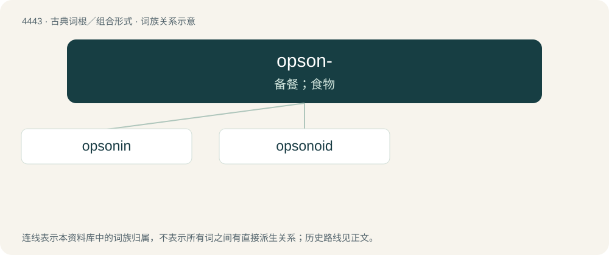

# 4442 · opson- — 备餐；食物

[总目录](../00_总目录_按常用程度.md)

**类型**：古典词根／组合形式　｜　**来源语言**：古希腊语

## 核心含义与来源

- 核心含义：备餐；食物
- 英文含义：cook, prepare for eating
- 词形：opson-

**来源词形**：ὀψωνεῖν (opsōneîn), (opsōnia)

## 词族图

## 单词速览（常用到不常用）

| 单词 | 音标 | 释义 |
|---|---|---|
| [opsonin](#w-1) | /ˈɒpsənɪn/ | n. 调理素；\[化\] 调理素 |
| [opsonoid](#w-2) |  | \[医\] 类调理素 |

## 逐词详解

### 1. opsonin

**词性**：名词　｜　**音标**：/ˈɒpsənɪn/

**中文释义**：n. 调理素；\[化\] 调理素

**英文义项**：Any chemical produced by the body, including antibodies and complement proteins, that causes a pathogen to be more susceptible to phagocytosis.

**词源与演化**：

From Ancient Greek ὀψωνέω (opsōnéō, “to purchase provisions, to buy victuals, to cater”) + -in.

### 2. opsonoid

**词性**：名词

**中文释义**：\[医\] 类调理素

**英文义项**：A supposed substance formed when opsonin combines with bacteria and undergoes heating, preventing further opsonization.
