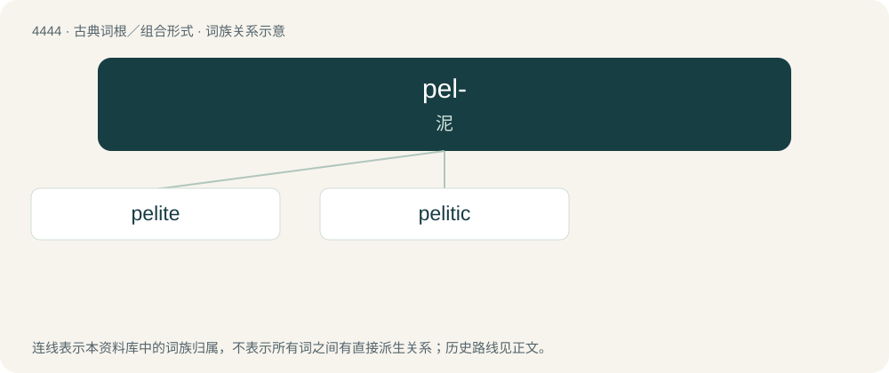

# 4443 · pel- — 泥

[总目录](../00_总目录_按常用程度.md)

**类型**：古典词根／组合形式　｜　**来源语言**：古希腊语

## 核心含义与来源

- 核心含义：泥
- 英文含义：clay, mud
- 词形：pel-

**来源词形**：πηλός (pēlós)

## 词族图

## 单词速览（常用到不常用）

| 单词 | 音标 | 释义 |
|---|---|---|
| [pelite](#w-1) | /ˈpiːlait/ | n. \[地\]泥质岩 |
| [pelitic](#w-2) | /piˈlitik/ | \[地质\]泥质岩的 |

## 逐词详解

### 1. pelite

**词性**：名词　｜　**音标**：/ˈpiːlait/

**中文释义**：n. \[地\]泥质岩

**英文义项**：A sedimentary rock containing very fine particles.

**词源与演化**：

From German Pelit, corresponding to Ancient Greek πηλός (pēlós, “mud, clay”) + -ite.

### 2. pelitic

**词性**：形容词　｜　**音标**：/piˈlitik/

**中文释义**：\[地质\]泥质岩的

**英文义项**：Relating to, or containing, pelite.

**构词拆分**：pelite + -ic

**词源与演化**：

From pelite + -ic.
