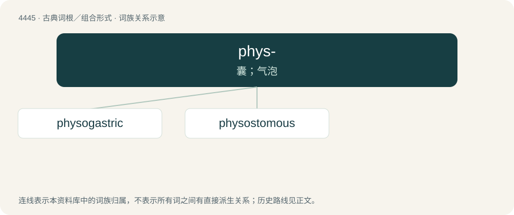

# 4444 · phys- — 囊；气泡

[总目录](../00_总目录_按常用程度.md)

**类型**：古典词根／组合形式　｜　**来源语言**：古希腊语

## 核心含义与来源

- 核心含义：囊；气泡
- 英文含义：bladder
- 词形：phys-

**来源词形**：φῦσα (phûsa)

## 词族图

## 单词速览（常用到不常用）

| 单词 | 音标 | 释义 |
|---|---|---|
| [physogastric](#w-1) | /,faisəˈ^æstrik/ | 膨腹的 |
| [physostomous](#w-2) | /faɪˈsɒstəməs/ | a. \[动物学\]; 通鳔的; 喉嘌类的 |

## 逐词详解

### 1. physogastric

**词性**：形容词　｜　**音标**：/,faisəˈ^æstrik/

**中文释义**：膨腹的

**英文义项**：Having a greatly distended abdomen.

### 2. physostomous

**词性**：形容词　｜　**音标**：/faɪˈsɒstəməs/

**中文释义**：a. \[动物学\]; 通鳔的; 喉嘌类的

**英文义项**：Having a duct to the air bladder. / Relating to the former grouping of fish Physostomi.

**词源与演化**：

See English physostome.

## 其他候选词

- Triplophysa
