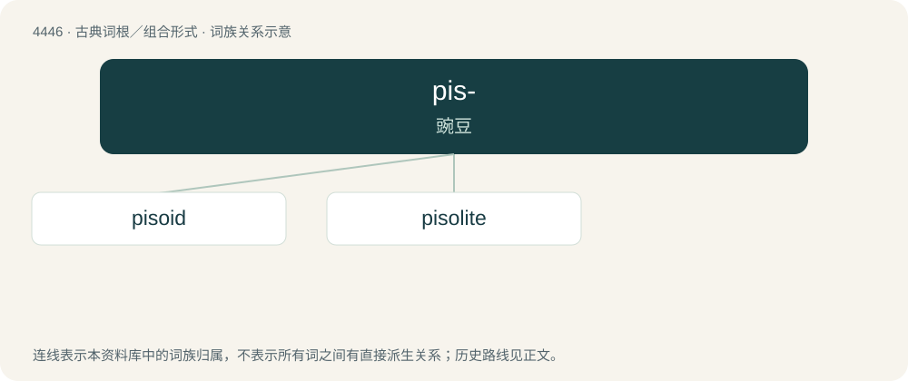

# 4445 · pis- — 豌豆

[总目录](../00_总目录_按常用程度.md)

**类型**：古典词根／组合形式　｜　**来源语言**：古希腊语

## 核心含义与来源

- 核心含义：豌豆
- 英文含义：pea
- 词形：pis-

**来源词形**：πίσος (písos)

## 词族图

## 单词速览（常用到不常用）

| 单词 | 音标 | 释义 |
|---|---|---|
| [pisoid](#w-1) |  | 【英文】A concretionary grain, typically of calcium carbonate, between a microid and a macroid in size. |
| [pisolite](#w-2) | /ˈpaisəlait/ | n. 豆石, 豆岩 |

## 逐词详解

### 1. pisoid

**词性**：名词

**英文义项**：A concretionary grain, typically of calcium carbonate, between a microid and a macroid in size.

**词源与演化**：

From Latin pisum + -oid.

### 2. pisolite

**词性**：名词　｜　**音标**：/ˈpaisəlait/

**中文释义**：n. 豆石, 豆岩

**英文义项**：A sedimentary rock formed from pisoids

**词源与演化**：

From Latin pisum + -lite.
