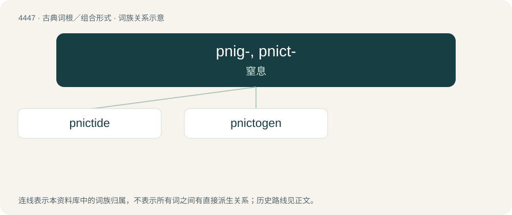

# 4446 · pnig-, pnict- — 窒息

[总目录](../00_总目录_按常用程度.md)

**类型**：古典词根／组合形式　｜　**来源语言**：古希腊语

## 核心含义与来源

- 核心含义：窒息
- 英文含义：choke
- 词形：pnig-, pnict-

**来源词形**：πνίγειν (pnígein), πνῖγος, πνῖγμα, πνιγμός, πνικτός, πνικτικός

## 词族图

## 单词速览（常用到不常用）

| 单词 | 音标 | 释义 |
|---|---|---|
| [pnictide](#w-1) | /ˈniktaid/ | 磷族元素化物 |
| [pnictogen](#w-2) | 英 /ˈpnɪktə(ʊ)d͡ʒən/；美 /ˈnɪktəd͡ʒən/ | 【英文】Any element from group 15 of the periodic table, which includes nitrogen, phosphorus, arsenic, antimony and bismuth. |

## 逐词详解

### 1. pnictide

**词性**：名词　｜　**音标**：/ˈniktaid/

**中文释义**：磷族元素化物

**英文义项**：Any binary compound of a pnictogen

**词源与演化**：

From Ancient Greek πνίγειν (pnígein, “to choke, to stifle”) (a property of nitrogen), from Pre-Greek, + -ide. By surface analysis, pnicto- + -ide.

### 2. pnictogen

**词性**：名词　｜　**音标**：英 /ˈpnɪktə(ʊ)d͡ʒən/；美 /ˈnɪktəd͡ʒən/

**英文义项**：Any element from group 15 of the periodic table, which includes nitrogen, phosphorus, arsenic, antimony and bismuth.

**词源与演化**：

From Ancient Greek πνικτός (pniktós) + -gen. The first element derives from Ancient Greek πνίγω (pnígō, “to choke, to stifle”) (a property of nitrogen), which is ultimately Pre-Greek. By surface analysis, pnicto- + -gen.
