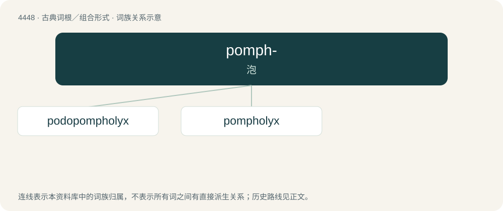

# 4447 · pomph- — 泡

[总目录](../00_总目录_按常用程度.md)

**类型**：古典词根／组合形式　｜　**来源语言**：古希腊语

## 核心含义与来源

- 核心含义：泡
- 英文含义：blister
- 词形：pomph-

**来源词形**：πομφός (pomphós), πομφόλυξ

## 词族图

## 单词速览（常用到不常用）

| 单词 | 音标 | 释义 |
|---|---|---|
| [podopompholyx](#w-1) |  | 【英文】pompholyx affecting the foot |
| [pompholyx](#w-2) | /ˈpɔmfə,liks/ | 燃烧锌或焙烧锌矿石所形成的不纯的氧化锌 |

## 逐词详解

### 1. podopompholyx

**词性**：名词

**英文义项**：pompholyx affecting the foot

**构词拆分**：podo- + pompholyx

**词源与演化**：

From podo- + pompholyx.

### 2. pompholyx

**词性**：名词　｜　**音标**：/ˈpɔmfə,liks/

**中文释义**：燃烧锌或焙烧锌矿石所形成的不纯的氧化锌

**英文义项**：dyshidrosis eczema / impure zinc oxide

**词源与演化**：

From Latin pompholyx, from Ancient Greek πομφόλυξ (pomphólux, “a bubble; the slag on the surface of smelted ore”).
