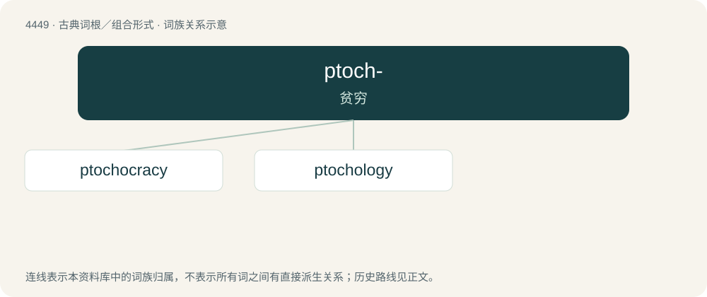

# 4448 · ptoch- — 贫穷

[总目录](../00_总目录_按常用程度.md)

**类型**：古典词根／组合形式　｜　**来源语言**：古希腊语

## 核心含义与来源

- 核心含义：贫穷
- 英文含义：poor
- 词形：ptoch-

**来源词形**：πτωχός (ptōkhós), πτωχότης

## 词族图

## 单词速览（常用到不常用）

| 单词 | 音标 | 释义 |
|---|---|---|
| [ptochocracy](#w-1) | 美 /toʊˈkɑkɹəsi/ | n. 穷人政治,穷人统治 |
| [ptochology](#w-2) |  | 【英文】The study of poverty, |

## 逐词详解

### 1. ptochocracy

**词性**：名词　｜　**音标**：美 /toʊˈkɑkɹəsi/

**中文释义**：n. 穷人政治,穷人统治

**英文义项**：A society or system ruled and dominated by the poor.

**词源与演化**：

From Ancient Greek πτωχός (ptōkhós, “beggar, poor”) + κράτος (krátos, “power, might”).

### 2. ptochology

**词性**：名词

**英文义项**：The study of poverty,

**词源与演化**：

From Ancient Greek πτωχός (ptōkhós, “beggar, poor”) + -logy.
