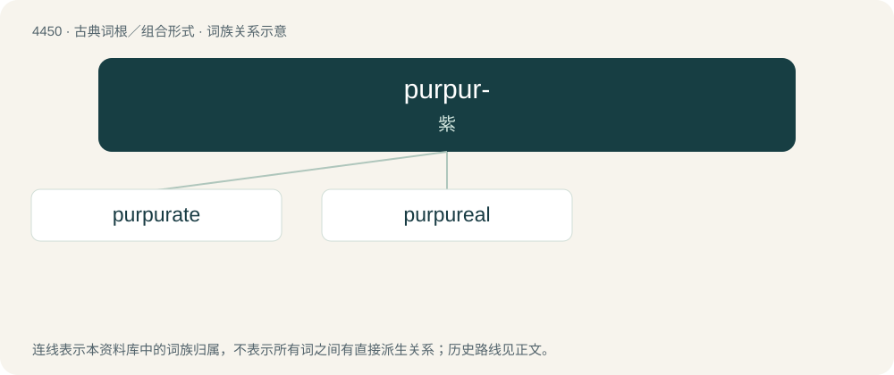

# 4449 · purpur- — 紫

[总目录](../00_总目录_按常用程度.md)

**类型**：古典词根／组合形式　｜　**来源语言**：拉丁语

## 核心含义与来源

- 核心含义：紫
- 英文含义：purple
- 词形：purpur-

**来源词形**：purpura

## 词族图

## 单词速览（常用到不常用）

| 单词 | 音标 | 释义 |
|---|---|---|
| [purpurate](#w-1) | /ˈpəːpjureit/ | n. \[化\]红紫酸盐 |
| [purpureal](#w-2) | 英 /pɜːˈpjʊə.ɹɪ.əl/；美 /pɝˈp(j)ʊ.ɹi.əl/ | a. &lt;诗&gt;紫色的 |

## 逐词详解

### 1. purpurate

**词性**：形容词　｜　**音标**：/ˈpəːpjureit/

**中文释义**：n. \[化\]红紫酸盐

**英文义项**：Of a purple colour.

**构词拆分**：Latin purpura (“the color purple”) + -ate (adjective-forming suffix)

**词源与演化**：

From Latin purpura (“the color purple”) + -ate (adjective-forming suffix).

### 2. purpureal

**词性**：形容词　｜　**音标**：英 /pɜːˈpjʊə.ɹɪ.əl/；美 /pɝˈp(j)ʊ.ɹi.əl/

**中文释义**：a. &lt;诗&gt;紫色的

**英文义项**：Of a purple colour.

**词源与演化**：

From Latin purpureus (“purple, violet; brown, reddish; clothed in purple; (figurative) brilliant, shining; beautiful”) + English -al (suffix meaning ‘of or pertaining to’ forming adjectives). Purpureus is either derived: \* from purpura (“the colour purple; purple-fish (Hexaplex trunculus)”) (from Ancient Greek πορφῠ́ρᾱ (porphŭ́rā, “purple-fish; purple dye obtained from it; purple-dyed cloth; purple stripe or other adornment of a garment”), from πορφύρω (porphúrō, “to redden”)) + -eus (suffix forming adjectives from nouns); or \* from Ancient Greek πορφύρεος (porphúreos, “of a purple colour”), from πορφῠ́ρᾱ (porphŭ́rā) (see above) + -εος (-eos).
