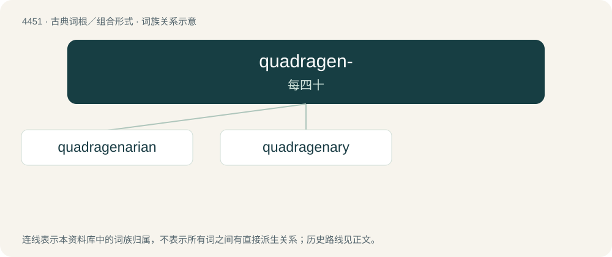

# 4450 · quadragen- — 每四十

[总目录](../00_总目录_按常用程度.md)

**类型**：古典词根／组合形式　｜　**来源语言**：拉丁语

## 核心含义与来源

- 核心含义：每四十
- 英文含义：forty each
- 词形：quadragen-

**来源词形**：quadrageni

## 词族图

## 单词速览（常用到不常用）

| 单词 | 音标 | 释义 |
|---|---|---|
| [quadragenarian](#w-1) | 英 /ˌkwɒdɹəd͡ʒɪˈnɛəɹɪən/；美 /ˌkwɑdɹəd͡ʒɪˈnɛɹiən/ | a. 四十多岁的；n. 四十多岁的人, 40至49岁的人 |
| [quadragenary](#w-2) | 美 /ˈkwɑ(ˌ)dɹæd͡ʒəˌnɛri/ | 【英文】Of or related to the number 40, particularly |

## 逐词详解

### 1. quadragenarian

**词性**：名词　｜　**音标**：英 /ˌkwɒdɹəd͡ʒɪˈnɛəɹɪən/；美 /ˌkwɑdɹəd͡ʒɪˈnɛɹiən/

**中文释义**：a. 四十多岁的；n. 四十多岁的人, 40至49岁的人

**英文义项**：Synonym of fortysomething: a person between 40 and 49 years old.

**词源与演化**：

From Latin quadrāgēnārius (“containing 40”) + -an, either directly or via French quadragénaire, from Latin quadrāgēnus (“40 each”) + -ārius (“-ary”), from quadrāgintā (“four tens, forty”). Cognate with quadragenary, quadragenarious, and quadragene.

### 2. quadragenary

**词性**：形容词　｜　**音标**：美 /ˈkwɑ(ˌ)dɹæd͡ʒəˌnɛri/

**英文义项**：Of or related to the number 40, particularly / Synonym of quadragenarian: lasting or aged forty years; forty-year-old.

**词源与演化**：

From Latin quadrāgēnārius (“containing 40”), either directly or via French quadragénaire, from Latin quadrāgēnus (“40 each”) + -ārius (“-ary”), from quadrāgintā (“four tens, forty”). Cognate with quadragenarian, quadragenarious, and quadragene.
