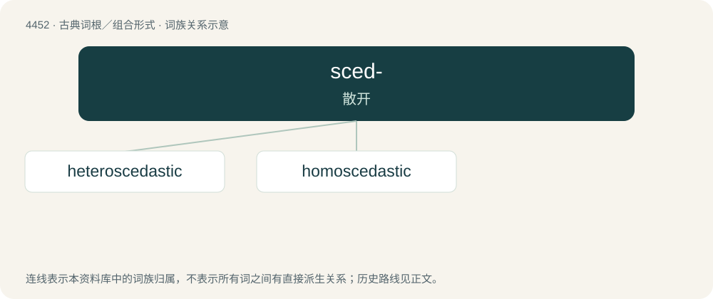

# 4451 · sced- — 散开

[总目录](../00_总目录_按常用程度.md)

**类型**：古典词根／组合形式　｜　**来源语言**：古希腊语

## 核心含义与来源

- 核心含义：散开
- 英文含义：scatter
- 词形：sced-

**来源词形**：σκεδαννύναι (skedannúnai), σκέδασις (skédasis), (skedastós), (skedastikós)

## 词族图

## 单词速览（常用到不常用）

| 单词 | 音标 | 释义 |
|---|---|---|
| [heteroscedastic](#w-1) | /,hetərəusəˈdæstik/ | \[数\]异方差的 |
| [homoscedastic](#w-2) | /,həuməs(k)iˈdæstik/ | a. \[统\]同方差的 |

## 逐词详解

### 1. heteroscedastic

**词性**：形容词　｜　**音标**：/,hetərəusəˈdæstik/

**中文释义**：\[数\]异方差的

**英文义项**：Exhibiting heteroscedasticity

**构词拆分**：hetero- + scedastic

**词源与演化**：

From hetero- + scedastic.

### 2. homoscedastic

**词性**：形容词　｜　**音标**：/,həuməs(k)iˈdæstik/

**中文释义**：a. \[统\]同方差的

**英文义项**：Having the same finite variance for all elements.

**词源与演化**：

From homo- + Ancient Greek σκεδαστός (skedastós, “able to be scattered”).
