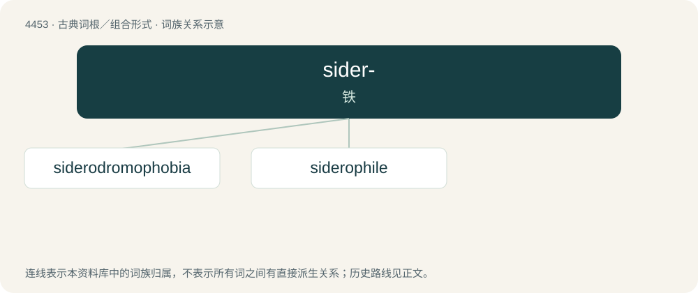

# 4452 · sider- — 铁

[总目录](../00_总目录_按常用程度.md)

**类型**：古典词根／组合形式　｜　**来源语言**：古希腊语

## 核心含义与来源

- 核心含义：铁
- 英文含义：iron
- 词形：sider-

**来源词形**：σίδηρος (sídēros), σιδήρεος

## 词族图

## 单词速览（常用到不常用）

| 单词 | 音标 | 释义 |
|---|---|---|
| [siderodromophobia](#w-1) |  | \[医\] 铁道恐怖, 火车恐怖 |
| [siderophile](#w-2) |  | 亲铁的 |

## 逐词详解

### 1. siderodromophobia

**词性**：名词

**中文释义**：\[医\] 铁道恐怖, 火车恐怖

**英文义项**：A morbid fear of railways.

**构词拆分**：sidero- + dromo- + -phobia

**词源与演化**：

From sidero- + dromo- + -phobia.

### 2. siderophile

**词性**：名词

**中文释义**：亲铁的

**英文义项**：In the Goldschmidt classification, an element that forms alloys easily with iron and is concentrated in the Earth's core. / A cell or tissue that has an affinity for iron.

**构词拆分**：sidero- + -phile

**词源与演化**：

From sidero- + -phile.
