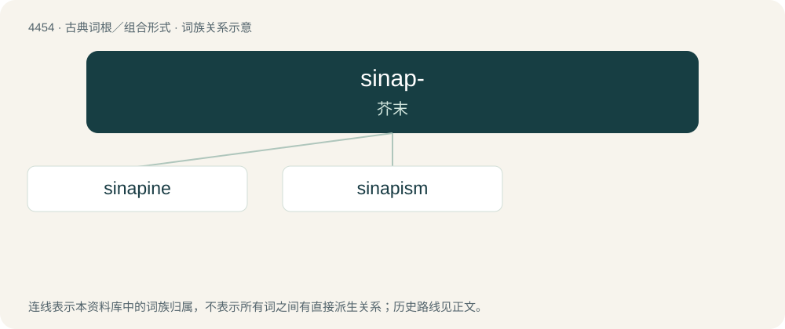

# 4453 · sinap- — 芥末

[总目录](../00_总目录_按常用程度.md)

**类型**：古典词根／组合形式　｜　**来源语言**：古希腊语

## 核心含义与来源

- 核心含义：芥末
- 英文含义：mustard
- 词形：sinap-

**来源词形**：σίναπι (sínapi), (sināpízein), (sināpismós)

## 词族图

## 单词速览（常用到不常用）

| 单词 | 音标 | 释义 |
|---|---|---|
| [sinapine](#w-1) | /ˈsinəpin/ | n. \[生化\]芥子酸胆碱 |
| [sinapism](#w-2) | /ˈsinəpizm/ | n. 芥子泥；\[医\] 芥子泥, 芥子硬膏 |

## 逐词详解

### 1. sinapine

**词性**：名词　｜　**音标**：/ˈsinəpin/

**中文释义**：n. \[生化\]芥子酸胆碱

**英文义项**：An alkaloidal amine found in seeds of black mustard (Brassica nigra, syns. Rhamphospermum nigrum, Sinapis erysimoides, Sinapis tetraedra, etc.), considered a choline ester of sinapic acid.

**词源与演化**：

Latin sinapi, sinapis (“mustard”), Ancient Greek: compare French sinapine.

### 2. sinapism

**词性**：名词　｜　**音标**：/ˈsinəpizm/

**中文释义**：n. 芥子泥；\[医\] 芥子泥, 芥子硬膏

**英文义项**：A mustard plaster.

**词源与演化**：

From Latin sināpi (“mustard”) + -ism.
