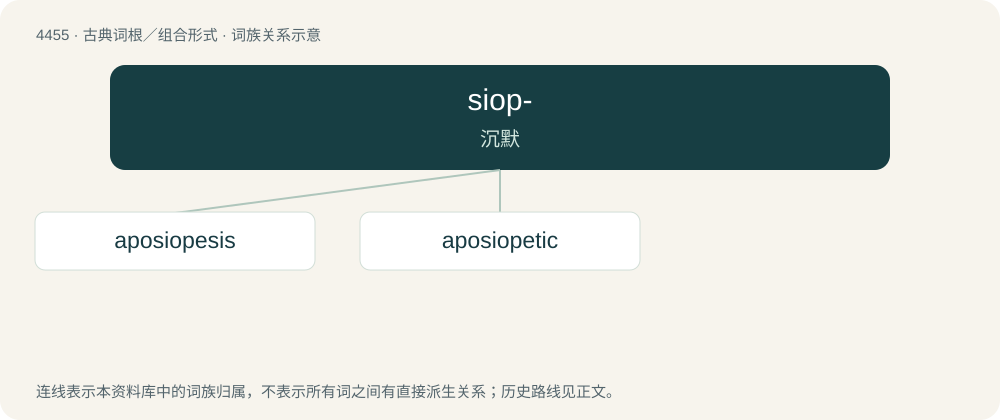

# 4454 · siop- — 沉默

[总目录](../00_总目录_按常用程度.md)

**类型**：古典词根／组合形式　｜　**来源语言**：古希腊语

## 核心含义与来源

- 核心含义：沉默
- 英文含义：silence
- 词形：siop-

**来源词形**：σιωπή (siōpḗ), σιωπᾶν (siōpân), σιωπητέος (siōpētéos), σιώπησις (siṓpēsis)

## 词族图

## 单词速览（常用到不常用）

| 单词 | 音标 | 释义 |
|---|---|---|
| [aposiopesis](#w-1) | /ˌæpəsaɪəˈpiːsɪs/ | n. 顿绝, 话语中断 |
| [aposiopetic](#w-2) | /,æpəusaiəuˈpetik/ | a. aposiopesis的变形 |

## 逐词详解

### 1. aposiopesis

**词性**：名词　｜　**音标**：/ˌæpəsaɪəˈpiːsɪs/

**中文释义**：n. 顿绝, 话语中断

**英文义项**：An abrupt breaking-off in speech, often indicated in print using an ellipsis (…) or an em dash (—).

**词源与演化**：

From Latin aposiopesis, from Ancient Greek ἀποσιώπησις (aposiṓpēsis), from ἀποσιωπάω (aposiōpáō, “be silent”), from ἀπό (apó, “off, from”) + σιωπάω (siōpáō, “to be silent”).

### 2. aposiopetic

**词性**：形容词　｜　**音标**：/,æpəusaiəuˈpetik/

**中文释义**：a. aposiopesis的变形

**英文义项**：Of or pertaining to aposiopesis.
