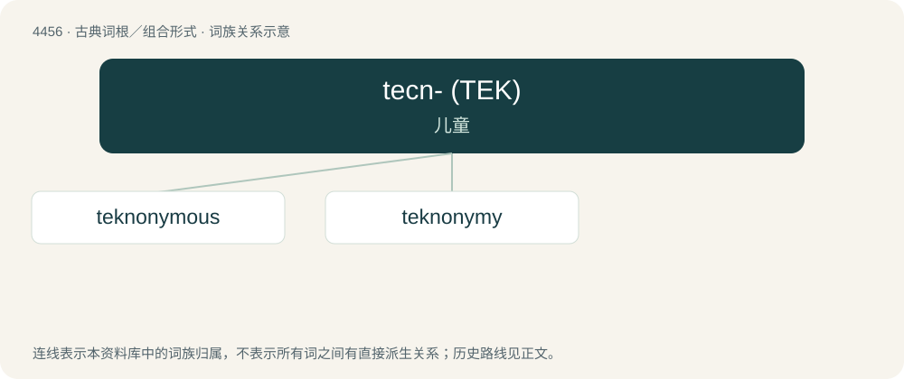

# 4455 · tecn- (ΤΕΚ) — 儿童

[总目录](../00_总目录_按常用程度.md)

**类型**：古典词根／组合形式　｜　**来源语言**：古希腊语

## 核心含义与来源

- 核心含义：儿童
- 英文含义：child
- 词形：tecn-

**来源词形**：τίκτω, τέκνον, τέκνου (téknon, téknou)

## 词族图

## 单词速览（常用到不常用）

| 单词 | 音标 | 释义 |
|---|---|---|
| [teknonymous](#w-1) |  | 【英文】Relating to teknonymy. |
| [teknonymy](#w-2) | /tɛkˈnɒnɪmi/ | n. 亲从子名制,因子女得名制(即父或母以"…的父"或"…的母"命名) |

## 逐词详解

### 1. teknonymous

**词性**：形容词

**英文义项**：Relating to teknonymy.

### 2. teknonymy

**词性**：名词　｜　**音标**：/tɛkˈnɒnɪmi/

**中文释义**：n. 亲从子名制,因子女得名制(即父或母以"…的父"或"…的母"命名)

**英文义项**：The cultural practice of referring to parents by the names of their children.

**构词拆分**：tecno- + -onymy

**词源与演化**：

From tecno- + -onymy.
