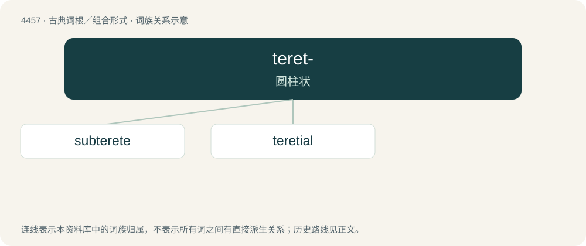

# 4456 · teret- — 圆柱状

[总目录](../00_总目录_按常用程度.md)

**类型**：古典词根／组合形式　｜　**来源语言**：拉丁语

## 核心含义与来源

- 核心含义：圆柱状
- 英文含义：rounded
- 词形：teret-

**来源词形**：teres, teretis

## 词族图

## 单词速览（常用到不常用）

| 单词 | 音标 | 释义 |
|---|---|---|
| [subterete](#w-1) | /ˈsʌbtərɪt/ | \[医\]近圆筒形的 |
| [teretial](#w-2) | /təˈɹiːʃiəl/ | 【英文】rounded |

## 逐词详解

### 1. subterete

**词性**：形容词　｜　**音标**：/ˈsʌbtərɪt/

**中文释义**：\[医\]近圆筒形的

**英文义项**：Somewhat terete.

**构词拆分**：sub- + terete

**词源与演化**：

From sub- + terete.

### 2. teretial

**词性**：形容词　｜　**音标**：/təˈɹiːʃiəl/

**英文义项**：rounded

**词源与演化**：

See terete.

**用法示例／搭配（非完整句）**：

> the teretial tracts in the floor of the fourth ventricle of the brain of some fishes

该用例对应义项：rounded
