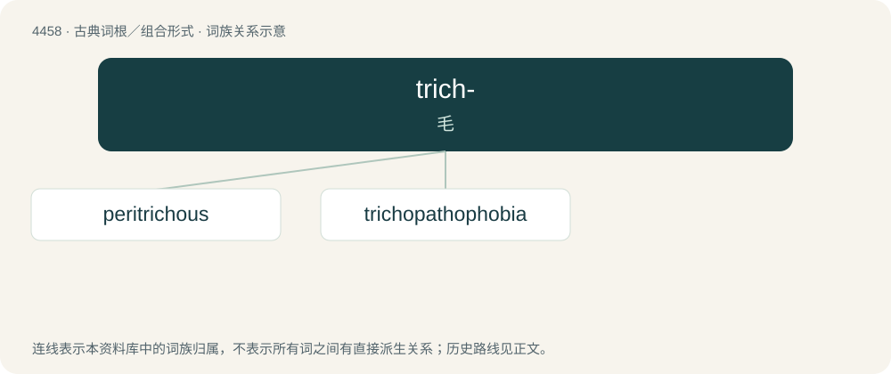

# 4457 · trich- — 毛

[总目录](../00_总目录_按常用程度.md)

**类型**：古典词根／组合形式　｜　**来源语言**：古希腊语

## 核心含义与来源

- 核心含义：毛
- 英文含义：hair
- 词形：trich-

**来源词形**：θρίξ, τριχός (trikhós)

## 词族图

## 单词速览（常用到不常用）

| 单词 | 音标 | 释义 |
|---|---|---|
| [peritrichous](#w-1) | /pəˈritrikəs/ | \[植\]周毛的(指菌) |
| [trichopathophobia](#w-2) |  | \[医\] 毛发病恐怖 |

## 逐词详解

### 1. peritrichous

**词性**：形容词　｜　**音标**：/pəˈritrikəs/

**中文释义**：\[植\]周毛的(指菌)

**英文义项**：Having flagella around the body or around the mouth

**构词拆分**：peri- + tricho- + -ous

**词源与演化**：

From peri- + tricho- + -ous.

### 2. trichopathophobia

**词性**：名词

**中文释义**：\[医\] 毛发病恐怖

**英文义项**：A fear relating to the colour, growth or disorders of hair.

**构词拆分**：tricho- + pathophobia

**词源与演化**：

From tricho- + pathophobia.

## 其他候选词

- Trichoptera
