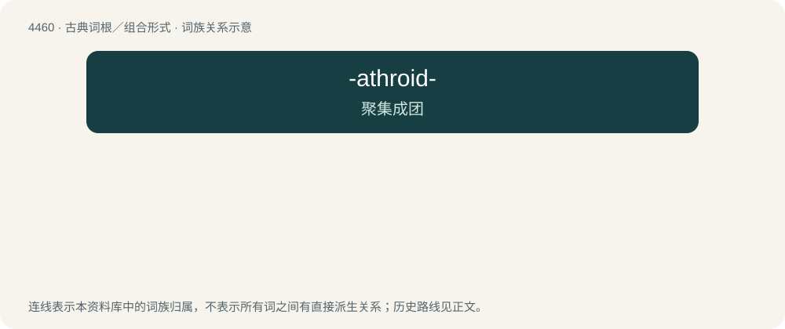

# 4459 · -athroid- — 聚集成团

[总目录](../00_总目录_按常用程度.md)

**类型**：古典词根／组合形式　｜　**来源语言**：古希腊语

## 核心含义与来源

- 核心含义：聚集成团
- 英文含义：gathered or lumped together
- 词形：-athroid-

**来源词形**：ἀθροίζειν (athroízein) "to gather together"

## 词族图

## 其他候选词

- epiathroid
- hypoathroid
