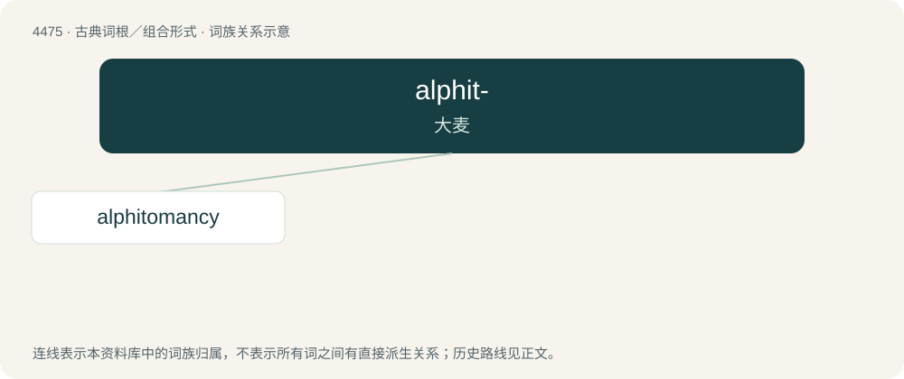

# 4474 · alphit- — 大麦

[总目录](../00_总目录_按常用程度.md)

**类型**：古典词根／组合形式　｜　**来源语言**：古希腊语

## 核心含义与来源

- 核心含义：大麦
- 英文含义：barley
- 词形：alphit-

**来源词形**：ἀλφός (alphós), ἄλφιτον, ἀλφίτου (álphiton, alphítou)

## 词族图

## 单词速览（常用到不常用）

| 单词 | 音标 | 释义 |
|---|---|---|
| [alphitomancy](#w-1) |  | 【英文】An Ancient Greek method of divination using barley meal, used for instance to reveal guilty parties; it entailed feeding a person or group barley meal, and judging those who felt no effects to be innocent, while judg |

## 逐词详解

### 1. alphitomancy

**词性**：名词

**英文义项**：An Ancient Greek method of divination using barley meal, used for instance to reveal guilty parties; it entailed feeding a person or group barley meal, and judging those who felt no effects to be innocent, while judging those who felt indigestion to be guilty.

**词源与演化**：

From Ancient Greek ἀλφῐτόμαντις (alphĭtómantis, “diviner who used barley meal”), from ἄλφῐτον (álphĭton, “barley meal”) and μαντεία (manteía, “prophecy”).
