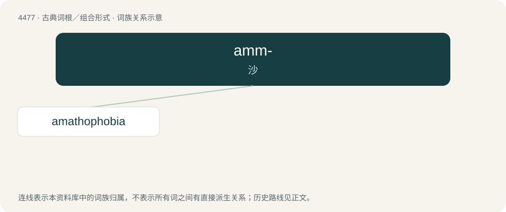

# 4476 · amm- — 沙

[总目录](../00_总目录_按常用程度.md)

**类型**：古典词根／组合形式　｜　**来源语言**：古希腊语

## 核心含义与来源

- 核心含义：沙
- 英文含义：sand
- 词形：amm-

**来源词形**：ἄμμος (ámmos), ἄμαθος (ámathos)

## 词族图

## 单词速览（常用到不常用）

| 单词 | 音标 | 释义 |
|---|---|---|
| [amathophobia](#w-1) |  | \[医\] 飞尘恐怖 |

## 逐词详解

### 1. amathophobia

**词性**：名词

**中文释义**：\[医\] 飞尘恐怖

**英文义项**：Fear of dust.

## 其他候选词

- Ammophila
