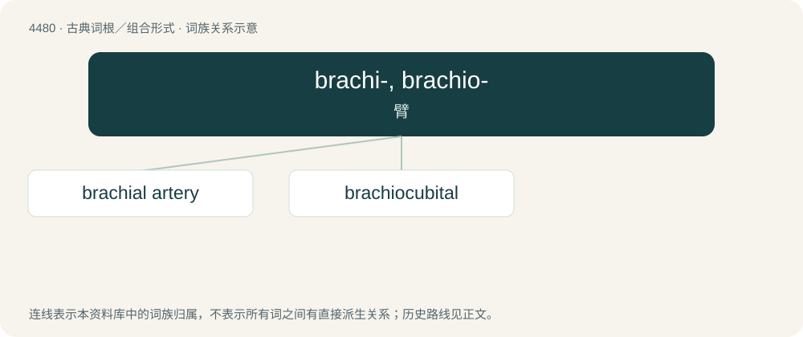

# 4480 · brachi-, brachio- — 臂

[总目录](../00_总目录_按常用程度.md)

**类型**：古典词根／组合形式　｜　**来源语言**：拉丁语 ← 古希腊语

## 核心含义与来源

- 核心含义：臂
- 英文含义：arm
- 词形：brachi-, brachio-

**来源词形**：bracchium

## 词族图

## 单词速览（常用到不常用）

| 单词 | 音标 | 释义 |
|---|---|---|
| [brachial artery](#w-1) | /ˈbreikiəl ˈɑːtəri/ | 肱动脉 |
| [brachiocubital](#w-2) |  | \[医\] 臂肘的 |

## 逐词详解

### 1. brachial artery

**词性**：名词　｜　**音标**：/ˈbreikiəl ˈɑːtəri/

**中文释义**：肱动脉

**英文义项**：The main artery of the upper arm that is a direct continuation of the axillary artery beginning at the inferior border of the teres major muscle, runs along the medial aspect of the upper arm, and divides into the radial and ulnar arteries at the cubital fossa.

### 2. brachiocubital

**词性**：形容词

**中文释义**：\[医\] 臂肘的

**英文义项**：Relating to the arm and to the elbow or forearm

**构词拆分**：brachio- + cubital

**词源与演化**：

From brachio- + cubital.

## 其他候选词

- brachiferous
