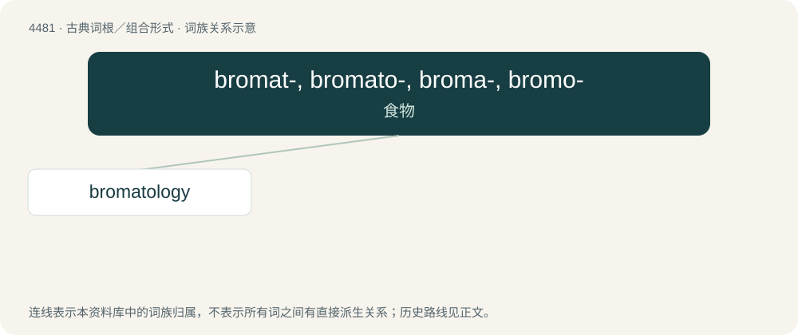

# 4481 · bromat-, bromato-, broma-, bromo- — 食物

[总目录](../00_总目录_按常用程度.md)

**类型**：古典词根／组合形式　｜　**来源语言**：古希腊语

## 核心含义与来源

- 核心含义：食物
- 英文含义：food
- 词形：bromat-, bromato-, broma-, bromo-

**来源词形**：βρῶμα (brôma)

## 词族图

## 单词速览（常用到不常用）

| 单词 | 音标 | 释义 |
|---|---|---|
| [bromatology](#w-1) | /bɹəʊməˈtɒləd͡ʒi/ | 饮食学, 食品善食学 |

## 逐词详解

### 1. bromatology

**词性**：名词　｜　**音标**：/bɹəʊməˈtɒləd͡ʒi/

**中文释义**：饮食学, 食品善食学

**英文义项**：The study of food.

**词源与演化**：

From Ancient Greek βρῶμα (brôma, “food”); and -λογία (-logía, “-logy”).

## 其他候选词

- bromatium
- bromateccrisis
- bromatherapy
- bromography
