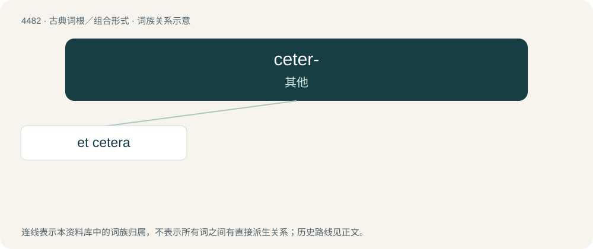

# 4482 · ceter- — 其他

[总目录](../00_总目录_按常用程度.md)

**类型**：古典词根／组合形式　｜　**来源语言**：拉丁语

## 核心含义与来源

- 核心含义：其他
- 英文含义：other
- 词形：ceter-

**来源词形**：ceterus

## 词族图

## 单词速览（常用到不常用）

| 单词 | 音标 | 释义 |
|---|---|---|
| [et cetera](#w-1) | /ˌɛt ˈsɛt(ə)ɹə/ | 以及其他等等, ...等等 |

## 逐词详解

### 1. et cetera

**词性**：名词　｜　**音标**：/ˌɛt ˈsɛt(ə)ɹə/

**中文释义**：以及其他等等, ...等等

**英文义项**：Something in addition, which can easily be understood.

**词源与演化**：

From Middle English et cetera, from Latin et cētera (“and the other things; and the rest of the things”).
