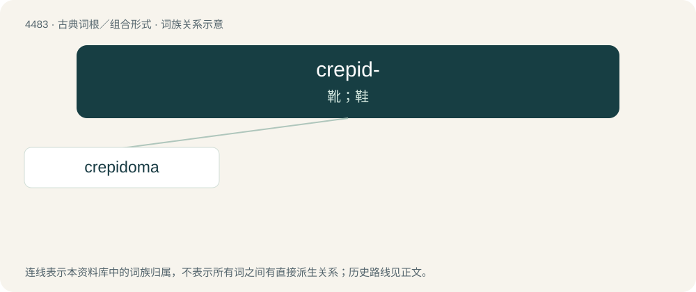

# 4483 · crepid- — 靴；鞋

[总目录](../00_总目录_按常用程度.md)

**类型**：古典词根／组合形式　｜　**来源语言**：古希腊语

## 核心含义与来源

- 核心含义：靴；鞋
- 英文含义：boot, shoe
- 词形：crepid-

**来源词形**：κρηπίς, κρηπίδος (krēpís, krēpídos), κρηπίδιον, κρηπίδωμα

## 词族图

## 单词速览（常用到不常用）

| 单词 | 音标 | 释义 |
|---|---|---|
| [crepidoma](#w-1) |  | 【英文】In classical Greek architecture, the platform of (usually three) levels upon which the superstructure of the building is erected, typically forming a series of steps. |

## 逐词详解

### 1. crepidoma

**词性**：名词

**英文义项**：In classical Greek architecture, the platform of (usually three) levels upon which the superstructure of the building is erected, typically forming a series of steps.

**词源与演化**：

From Ancient Greek κρηπίδωμα (krēpídōma).
