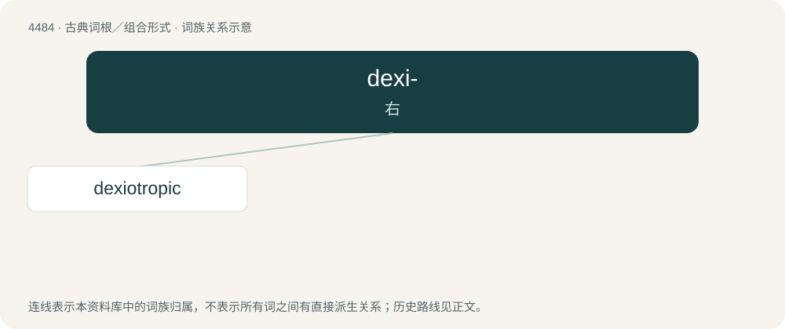

# 4484 · dexi- — 右

[总目录](../00_总目录_按常用程度.md)

**类型**：古典词根／组合形式　｜　**来源语言**：古希腊语

## 核心含义与来源

- 核心含义：右
- 英文含义：right
- 词形：dexi-

**来源词形**：δεξιός (dexiós)

## 词族图

## 单词速览（常用到不常用）

| 单词 | 音标 | 释义 |
|---|---|---|
| [dexiotropic](#w-1) | /,deksiəˈtrɔpik/ | a. 向右的；n. 右旋 |

## 逐词详解

### 1. dexiotropic

**词性**：形容词　｜　**音标**：/,deksiəˈtrɔpik/

**中文释义**：a. 向右的；n. 右旋

**英文义项**：Having the form of a right-handed spiral

## 其他候选词

- Dexiarchia
