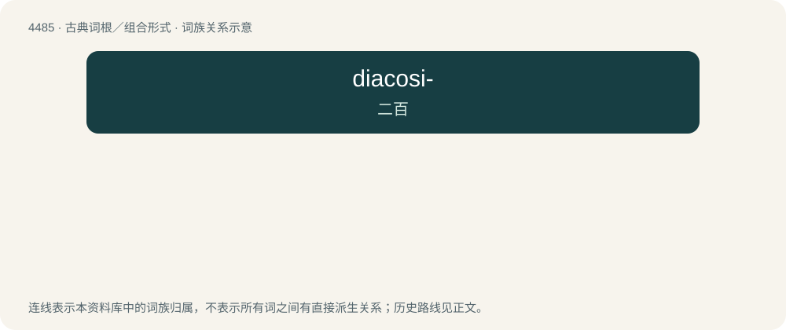

# 4485 · diacosi- — 二百

[总目录](../00_总目录_按常用程度.md)

**类型**：古典词根／组合形式　｜　**来源语言**：古希腊语

## 核心含义与来源

- 核心含义：二百
- 英文含义：two hundred
- 词形：diacosi-

**来源词形**：διακόσιοι (diakósioi), διακοσιάκις "two hundred times"

## 词族图

## 其他候选词

- diacosigon
- diacosipentecontaheptagon
