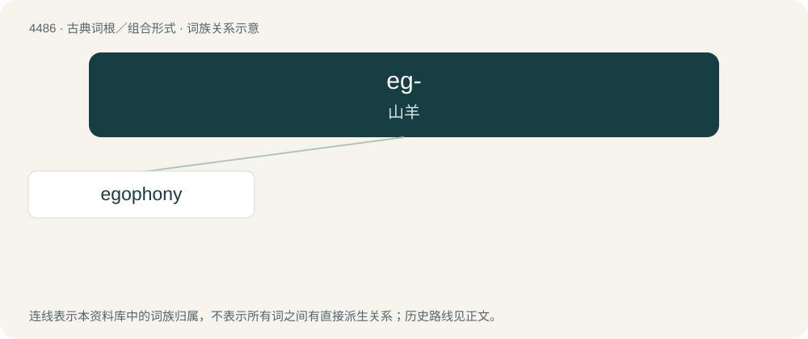

# 4486 · eg- — 山羊

[总目录](../00_总目录_按常用程度.md)

**类型**：古典词根／组合形式　｜　**来源语言**：古希腊语

## 核心含义与来源

- 核心含义：山羊
- 英文含义：goat
- 词形：eg-

**来源词形**：αἴξ, αἰγός (aíx, aigós)

## 词族图

## 单词速览（常用到不常用）

| 单词 | 音标 | 释义 |
|---|---|---|
| [egophony](#w-1) |  | \[医\] 羊音 |

## 逐词详解

### 1. egophony

**词性**：名词

**中文释义**：\[医\] 羊音

**英文义项**：A bleating sound sometimes observed in patients with various lung conditions.

**构词拆分**：ego- (“goat”) + -phony

**词源与演化**：

From ego- (“goat”) + -phony.
