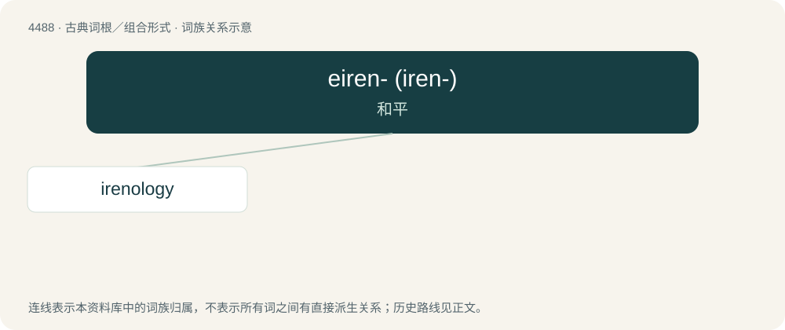

# 4488 · eiren- (iren-) — 和平

[总目录](../00_总目录_按常用程度.md)

**类型**：古典词根／组合形式　｜　**来源语言**：古希腊语

## 核心含义与来源

- 核心含义：和平
- 英文含义：peace
- 词形：eiren-

**来源词形**：εἰρήνη (eirḗnē) "peace"

## 词族图

## 单词速览（常用到不常用）

| 单词 | 音标 | 释义 |
|---|---|---|
| [irenology](#w-1) | /,airəˈnɔlədʒi/ | n. (国际关系中的)和平学 |

## 逐词详解

### 1. irenology

**词性**：名词　｜　**音标**：/,airəˈnɔlədʒi/

**中文释义**：n. (国际关系中的)和平学

**英文义项**：The study of peace.

**词源与演化**：

From Ancient Greek εἰρήνη (eirḗnē, “peace”) + -logy.

## 其他候选词

- irenic (eirenic)
