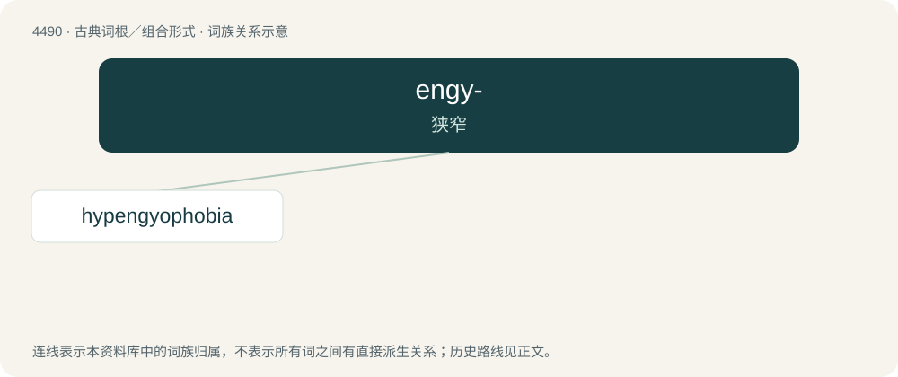

# 4490 · engy- — 狭窄

[总目录](../00_总目录_按常用程度.md)

**类型**：古典词根／组合形式　｜　**来源语言**：古希腊语

## 核心含义与来源

- 核心含义：狭窄
- 英文含义：narrow
- 词形：engy-

**来源词形**：ἐγγύς (engús)

## 词族图

## 单词速览（常用到不常用）

| 单词 | 音标 | 释义 |
|---|---|---|
| [hypengyophobia](#w-1) | /hai,pendʒiəˈfəubiə/ | \[心理\]责任恐怖 |

## 逐词详解

### 1. hypengyophobia

**词性**：名词　｜　**音标**：/hai,pendʒiəˈfəubiə/

**中文释义**：\[心理\]责任恐怖

**英文义项**：A fear of responsibility, or of neglecting one's responsibilities.

**构词拆分**：hypengyo- + -phobia

**词源与演化**：

Analyzable as hypengyo- + -phobia, the former from Ancient Greek ὑπέγγυος (hupénguos, “liable”).

## 其他候选词

- Engystomops
