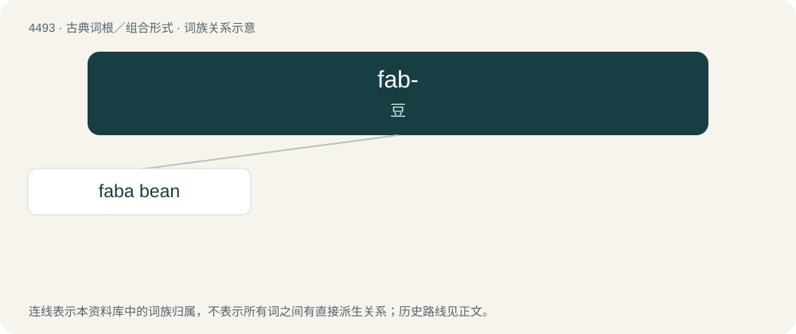

# 4493 · fab- — 豆

[总目录](../00_总目录_按常用程度.md)

**类型**：古典词根／组合形式　｜　**来源语言**：拉丁语

## 核心含义与来源

- 核心含义：豆
- 英文含义：bean
- 词形：fab-

**来源词形**：faba

## 词族图

## 单词速览（常用到不常用）

| 单词 | 音标 | 释义 |
|---|---|---|
| [faba bean](#w-1) |  | 【英文】Synonym of fava bean (Vicia faba). |

## 逐词详解

### 1. faba bean

**词性**：名词

**英文义项**：Synonym of fava bean (Vicia faba).
