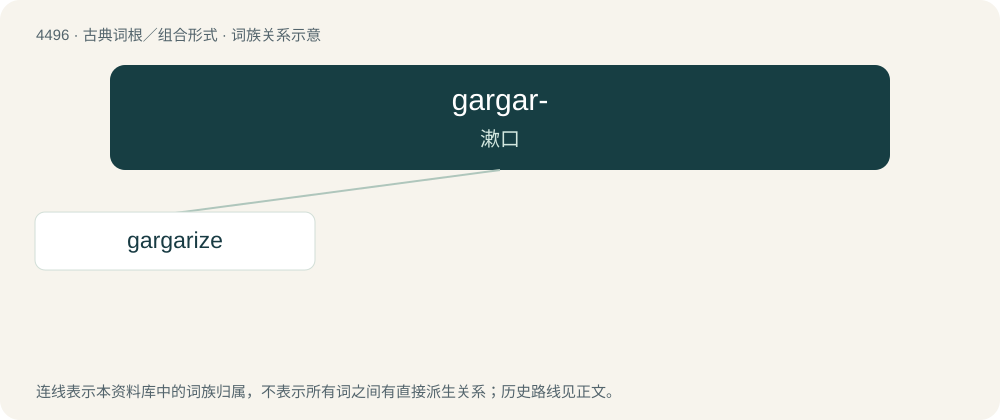

# 4496 · gargar- — 漱口

[总目录](../00_总目录_按常用程度.md)

**类型**：古典词根／组合形式　｜　**来源语言**：古希腊语

## 核心含义与来源

- 核心含义：漱口
- 英文含义：gargle
- 词形：gargar-

**来源词形**：γαργαρίζειν (gargarízein), γαργαρισμός (gargarismós), γαργαρεών

## 词族图

## 单词速览（常用到不常用）

| 单词 | 音标 | 释义 |
|---|---|---|
| [gargarize](#w-1) | /ˈɡɑː(ɹ)ɡəɹaɪz/ | 【英文】To gargle (rinse or wash mouth and throat). |

## 逐词详解

### 1. gargarize

**词性**：动词　｜　**音标**：/ˈɡɑː(ɹ)ɡəɹaɪz/

**英文义项**：To gargle (rinse or wash mouth and throat).

**词源与演化**：

From Latin gargarizo, from Ancient Greek γαργαρίζω (gargarízō).
