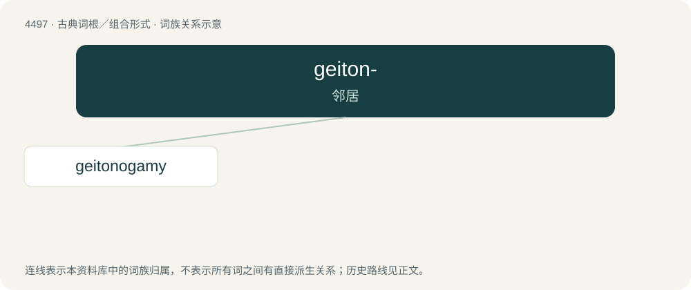

# 4497 · geiton- — 邻居

[总目录](../00_总目录_按常用程度.md)

**类型**：古典词根／组合形式　｜　**来源语言**：古希腊语

## 核心含义与来源

- 核心含义：邻居
- 英文含义：neighbor
- 词形：geiton-

**来源词形**：γείτων, γείτονος (geítōn, geítonos), γειτόνημα

## 词族图

## 单词速览（常用到不常用）

| 单词 | 音标 | 释义 |
|---|---|---|
| [geitonogamy](#w-1) | /,^aitəˈnɔ^əmi/ | n. \[植\]同株授粉 |

## 逐词详解

### 1. geitonogamy

**词性**：名词　｜　**音标**：/,^aitəˈnɔ^əmi/

**中文释义**：n. \[植\]同株授粉

**英文义项**：Transfer of pollen grains from the anther of a flower to the stigma of another flower of the same plant.

**词源与演化**：

From Ancient Greek γείτων (geítōn, “neighbour”, geitono-) + -gamy (“marriage”).
