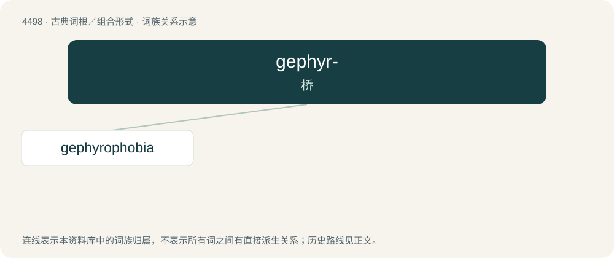

# 4498 · gephyr- — 桥

[总目录](../00_总目录_按常用程度.md)

**类型**：古典词根／组合形式　｜　**来源语言**：古希腊语

## 核心含义与来源

- 核心含义：桥
- 英文含义：bridge
- 词形：gephyr-

**来源词形**：γέφυρα (géphura), γεφυρόω

## 词族图

## 单词速览（常用到不常用）

| 单词 | 音标 | 释义 |
|---|---|---|
| [gephyrophobia](#w-1) | /dʒəˌfaɪɹəˈfoʊbiə/ | 过桥恐怖, 临水恐怖 |

## 逐词详解

### 1. gephyrophobia

**词性**：名词　｜　**音标**：/dʒəˌfaɪɹəˈfoʊbiə/

**中文释义**：过桥恐怖, 临水恐怖

**英文义项**：An inordinate fear of bridges, especially crossing bridges.

**词源与演化**：

From Ancient Greek γέφυρα (géphura, “bridge”) + -phobia.

**例句**：

> Venice is a place to avoid if you suffer from gephyrophobia.

该用例对应义项：An inordinate fear of bridges, especially crossing bridges.
