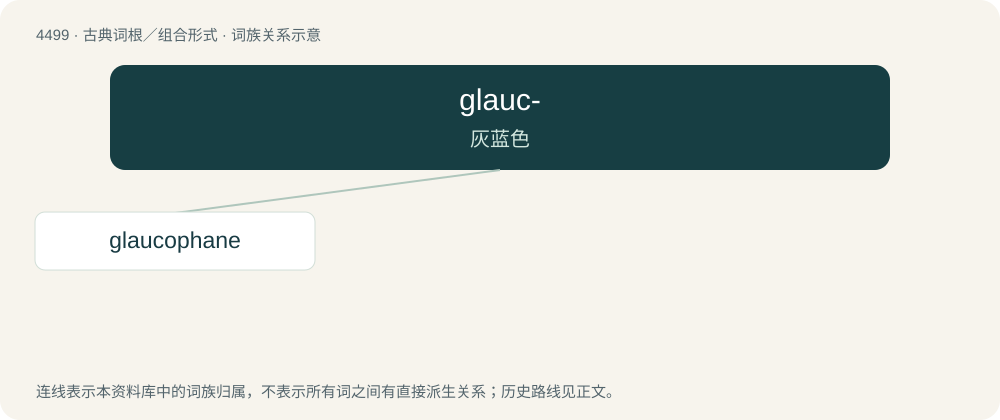

# 4499 · glauc- — 灰蓝色

[总目录](../00_总目录_按常用程度.md)

**类型**：古典词根／组合形式　｜　**来源语言**：古希腊语

## 核心含义与来源

- 核心含义：灰蓝色
- 英文含义：gray
- 词形：glauc-

**来源词形**：γλαυκός (glaukós), γλαυκότης, γλαύξ, γλαῦκος

## 词族图

## 单词速览（常用到不常用）

| 单词 | 音标 | 释义 |
|---|---|---|
| [glaucophane](#w-1) | /ˈ^lɔːkə,fein/ | 蓝闪石 |

## 逐词详解

### 1. glaucophane

**词性**：名词　｜　**音标**：/ˈ^lɔːkə,fein/

**中文释义**：蓝闪石

**英文义项**：A blue amphibole mineral, a mixed aluminate of sodium, magnesium and aluminium that exhibits pleochroism, with the chemical formula Na₂(Mg,Fe²⁺)₃Al₂Si₈O₂₂(OH)₂.

## 其他候选词

- Glaucopsyche
- glaucophobia
