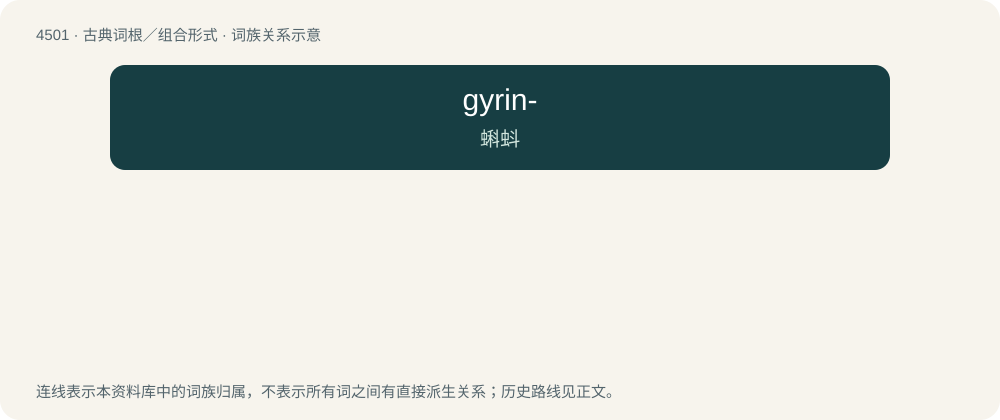

# 4501 · gyrin- — 蝌蚪

[总目录](../00_总目录_按常用程度.md)

**类型**：古典词根／组合形式　｜　**来源语言**：古希腊语

## 核心含义与来源

- 核心含义：蝌蚪
- 英文含义：tadpole
- 词形：gyrin-

**来源词形**：γυρός, γυρῖνος (gurós, gurînos), γυρινώδης (gurinṓdēs)

## 词族图

## 其他候选词

- Gyrinophilus
