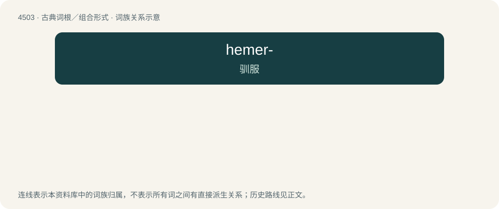

# 4503 · hemer- — 驯服

[总目录](../00_总目录_按常用程度.md)

**类型**：古典词根／组合形式　｜　**来源语言**：古希腊语

## 核心含义与来源

- 核心含义：驯服
- 英文含义：tame
- 词形：hemer-

**来源词形**：ἥμερος (hḗmeros), ἡμερότης (hēmerótēs)

## 词族图

## 其他候选词

- hemeroby
- hemerochora
- hemerophile
