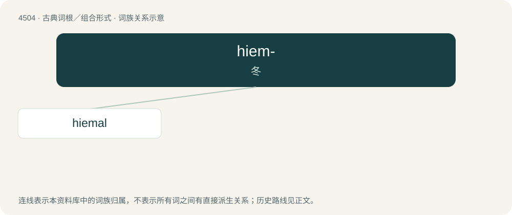

# 4504 · hiem- — 冬

[总目录](../00_总目录_按常用程度.md)

**类型**：古典词根／组合形式　｜　**来源语言**：拉丁语

## 核心含义与来源

- 核心含义：冬
- 英文含义：winter
- 词形：hiem-

**来源词形**：hiems

## 词族图

## 单词速览（常用到不常用）

| 单词 | 音标 | 释义 |
|---|---|---|
| [hiemal](#w-1) | /ˈhaiiməl/ | a. 冬季的, 寒冷的 |

## 逐词详解

### 1. hiemal

**词性**：形容词　｜　**音标**：/ˈhaiiməl/

**中文释义**：a. 冬季的, 寒冷的

**英文义项**：Of or pertaining to winter, wintry.

**词源与演化**：

From Latin hiemālis (“pertaining to winter”), from hiems (“winter”). More at hibernate.
