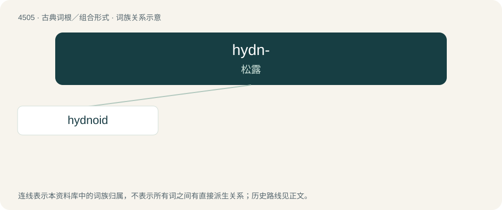

# 4505 · hydn- — 松露

[总目录](../00_总目录_按常用程度.md)

**类型**：古典词根／组合形式　｜　**来源语言**：古希腊语

## 核心含义与来源

- 核心含义：松露
- 英文含义：truffle
- 词形：hydn-

**来源词形**：ὕδνον (húdnon)

## 词族图

## 单词速览（常用到不常用）

| 单词 | 音标 | 释义 |
|---|---|---|
| [hydnoid](#w-1) | /ˈhid,nɔid/ | 猴头菌的 |

## 逐词详解

### 1. hydnoid

**词性**：名词　｜　**音标**：/ˈhid,nɔid/

**中文释义**：猴头菌的

**英文义项**：One of a group of fungi that have basidiocarps producing spores on tooth- or spine-like projections.

## 其他候选词

- Hydnum
