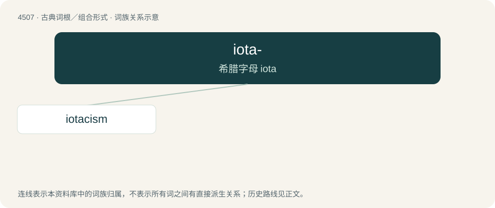

# 4507 · iota- — 希腊字母 iota

[总目录](../00_总目录_按常用程度.md)

**类型**：古典词根／组合形式　｜　**来源语言**：古希腊语

## 核心含义与来源

- 核心含义：希腊字母 iota
- 英文含义：I, i
- 词形：iota-

**来源词形**：iota

## 词族图

## 单词速览（常用到不常用）

| 单词 | 音标 | 释义 |
|---|---|---|
| [iotacism](#w-1) | /aiˈəutəsizm/ | 希腊字母I(iota)或其发音的过分使用和重复 |

## 逐词详解

### 1. iotacism

**词性**：名词　｜　**音标**：/aiˈəutəsizm/

**中文释义**：希腊字母I(iota)或其发音的过分使用和重复

**英文义项**：Pronunciation of another vowel or diphthong as \[i\], or a vowel shift resulting in such pronunciation, especially in Greek. / A misspelling resulting from such pronunciation.

**构词拆分**：iota + -cism

**词源与演化**：

From Ancient Greek ἰωτακισμός (iōtakismós), by surface analysis from iota + -cism (phenomenon related to a specific phoneme).
