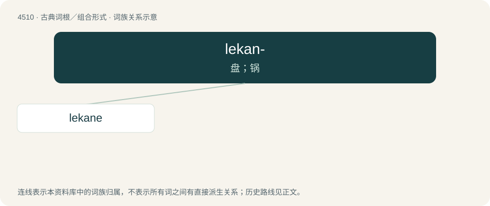

# 4510 · lekan- — 盘；锅

[总目录](../00_总目录_按常用程度.md)

**类型**：古典词根／组合形式　｜　**来源语言**：古希腊语

## 核心含义与来源

- 核心含义：盘；锅
- 英文含义：dish, pot
- 词形：lekan-

**来源词形**：λεκάνη (lekánē)

## 词族图

## 单词速览（常用到不常用）

| 单词 | 音标 | 释义 |
|---|---|---|
| [lekane](#w-1) | /ˈlɛkəni/ | 【英文】An Ancient Greek bowl or basin with horizontal handles. |

## 逐词详解

### 1. lekane

**词性**：名词　｜　**音标**：/ˈlɛkəni/

**英文义项**：An Ancient Greek bowl or basin with horizontal handles.

**词源与演化**：

From Ancient Greek λεκάνη (lekánē).
