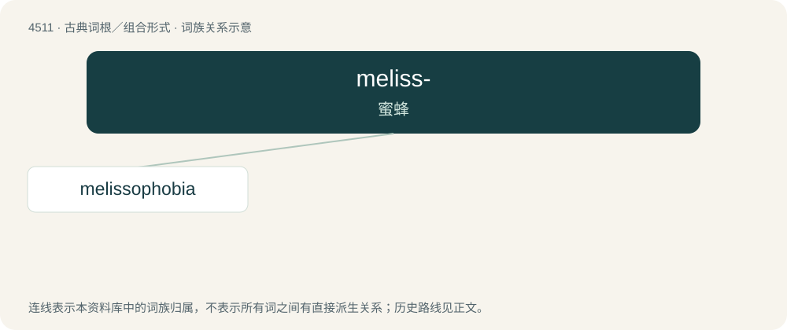

# 4511 · meliss- — 蜜蜂

[总目录](../00_总目录_按常用程度.md)

**类型**：古典词根／组合形式　｜　**来源语言**：古希腊语

## 核心含义与来源

- 核心含义：蜜蜂
- 英文含义：bee
- 词形：meliss-

**来源词形**：μέλισσα (mélissa)

## 词族图

## 单词速览（常用到不常用）

| 单词 | 音标 | 释义 |
|---|---|---|
| [melissophobia](#w-1) | /məˈlisəˈfəbiə/ | \[心理\]惧蜂症 |

## 逐词详解

### 1. melissophobia

**词性**：名词　｜　**音标**：/məˈlisəˈfəbiə/

**中文释义**：\[心理\]惧蜂症

**英文义项**：A morbid fear of bees.

**词源与演化**：

From Ancient Greek μέλισσα (mélissa, “bee”) + -phobia. By surface analysis, melisso- + -phobia.
