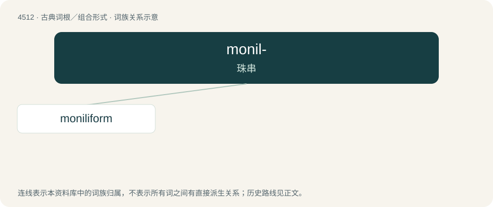

# 4512 · monil- — 珠串

[总目录](../00_总目录_按常用程度.md)

**类型**：古典词根／组合形式　｜　**来源语言**：拉丁语

## 核心含义与来源

- 核心含义：珠串
- 英文含义：string of beads
- 词形：monil-

**来源词形**：monile

## 词族图

## 单词速览（常用到不常用）

| 单词 | 音标 | 释义 |
|---|---|---|
| [moniliform](#w-1) | /məuˈnilifɒːm/ | a. 念珠形的；\[医\] 念珠形的 |

## 逐词详解

### 1. moniliform

**词性**：形容词　｜　**音标**：/məuˈnilifɒːm/

**中文释义**：a. 念珠形的；\[医\] 念珠形的

**英文义项**：Having a form resembling a string of beads, where the component parts or segments are more or less uniform in size and are spherical or rounded in shape.

**词源与演化**：

Borrowed from Latin monīlifōrmis.

## 其他候选词

- monilifer
- Moniliformida
