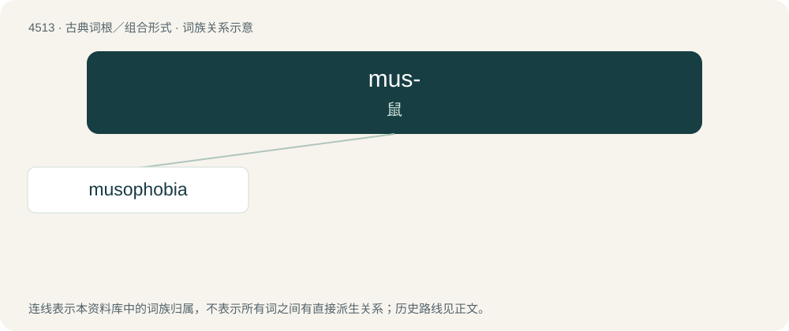

# 4513 · mus- — 鼠

[总目录](../00_总目录_按常用程度.md)

**类型**：古典词根／组合形式　｜　**来源语言**：古希腊语／拉丁语

## 核心含义与来源

- 核心含义：鼠
- 英文含义：mouse
- 词形：mus-

**来源词形**：μῦς, μυός (mûs, muós) / mus, muris

## 词族图

## 单词速览（常用到不常用）

| 单词 | 音标 | 释义 |
|---|---|---|
| [musophobia](#w-1) | /,mjuːzəˈfəubiə/ | 音乐恐怖 |

## 逐词详解

### 1. musophobia

**词性**：名词　｜　**音标**：/,mjuːzəˈfəubiə/

**中文释义**：音乐恐怖

**英文义项**：The fear of mice (and rats).

**词源与演化**：

From Latin mūs (“mouse”) or Ancient Greek μῦς (mûs, “mouse”) + -phobia.
