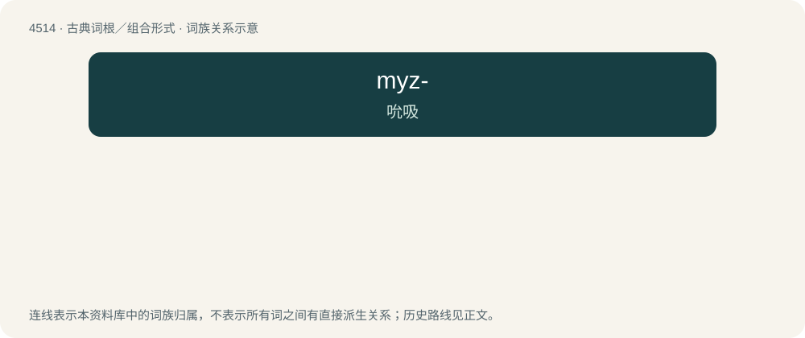

# 4514 · myz- — 吮吸

[总目录](../00_总目录_按常用程度.md)

**类型**：古典词根／组合形式　｜　**来源语言**：古希腊语

## 核心含义与来源

- 核心含义：吮吸
- 英文含义：suck
- 词形：myz-

**来源词形**：μυζάω (muzáō), μύζησις (múzēsis)

## 词族图

## 其他候选词

- Myzopoda
