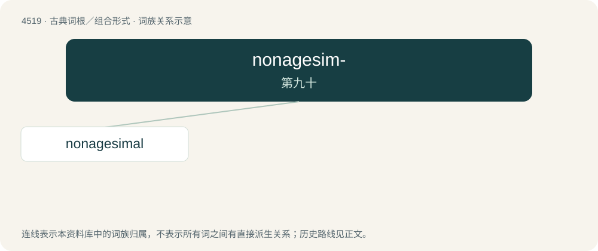

# 4519 · nonagesim- — 第九十

[总目录](../00_总目录_按常用程度.md)

**类型**：古典词根／组合形式　｜　**来源语言**：拉丁语

## 核心含义与来源

- 核心含义：第九十
- 英文含义：ninetieth
- 词形：nonagesim-

**来源词形**：nonagesimus

## 词族图

## 单词速览（常用到不常用）

| 单词 | 音标 | 释义 |
|---|---|---|
| [nonagesimal](#w-1) | /ˈnəʊnɪdʒesɪməl/ | 黄道地平最高点 |

## 逐词详解

### 1. nonagesimal

**词性**：名词　｜　**音标**：/ˈnəʊnɪdʒesɪməl/

**中文释义**：黄道地平最高点

**英文义项**：The middle to highest point of a part of an ecliptic that is above the horizon at any period of time.
