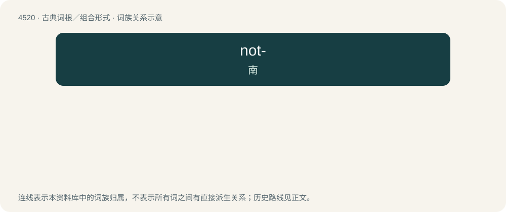

# 4520 · not- — 南

[总目录](../00_总目录_按常用程度.md)

**类型**：古典词根／组合形式　｜　**来源语言**：古希腊语

## 核心含义与来源

- 核心含义：南
- 英文含义：south
- 词形：not-

**来源词形**：νότος (nótos)

## 词族图

## 其他候选词

- Notogaea
- Notomys
- Nototherium
