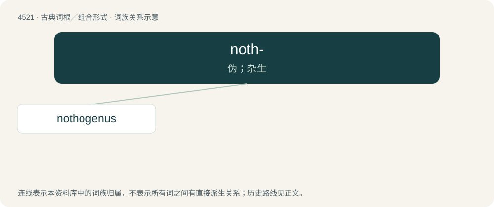

# 4521 · noth- — 伪；杂生

[总目录](../00_总目录_按常用程度.md)

**类型**：古典词根／组合形式　｜　**来源语言**：古希腊语

## 核心含义与来源

- 核心含义：伪；杂生
- 英文含义：spurious
- 词形：noth-

**来源词形**：νόθος (nóthos)

## 词族图

## 单词速览（常用到不常用）

| 单词 | 音标 | 释义 |
|---|---|---|
| [nothogenus](#w-1) |  | 【英文】A genus denoting a hybrid or cross. |

## 逐词详解

### 1. nothogenus

**词性**：名词

**英文义项**：A genus denoting a hybrid or cross.

**构词拆分**：notho- + genus

**词源与演化**：

From notho- + genus.
