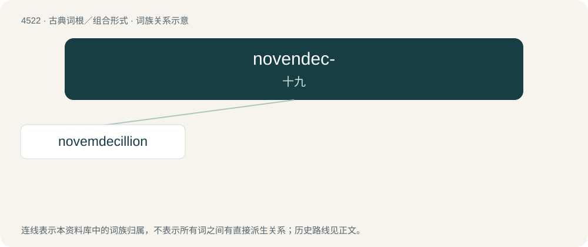

# 4522 · novendec- — 十九

[总目录](../00_总目录_按常用程度.md)

**类型**：古典词根／组合形式　｜　**来源语言**：拉丁语

## 核心含义与来源

- 核心含义：十九
- 英文含义：nineteen
- 词形：novendec-

**来源词形**：novendecim

## 词族图

## 单词速览（常用到不常用）

| 单词 | 音标 | 释义 |
|---|---|---|
| [novemdecillion](#w-1) | /ˌnoʊvəmdəˈsɪl.i.ən/ | a. (英,德)10的114次幂, (美,法)10的60次幂 |

## 逐词详解

### 1. novemdecillion

**词性**：数词　｜　**音标**：/ˌnoʊvəmdəˈsɪl.i.ən/

**中文释义**：a. (英,德)10的114次幂, (美,法)10的60次幂

**英文义项**：10⁶⁰. / 10¹¹⁴.

**词源与演化**：

From Latin novemdec(im) (“nineteen”) + -illion; compare tredecillion, quattuordecillion, etc.
