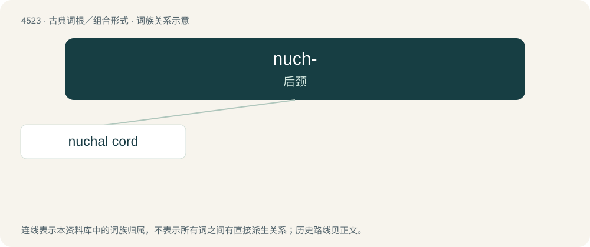

# 4523 · nuch- — 后颈

[总目录](../00_总目录_按常用程度.md)

**类型**：古典词根／组合形式　｜　**来源语言**：拉丁语

## 核心含义与来源

- 核心含义：后颈
- 英文含义：back of neck
- 词形：nuch-

**来源词形**：nucha

## 词族图

## 单词速览（常用到不常用）

| 单词 | 音标 | 释义 |
|---|---|---|
| [nuchal cord](#w-1) |  | 【英文】A condition in which the umbilical cord becomes wrapped around the fetus's neck. |

## 逐词详解

### 1. nuchal cord

**词性**：名词

**英文义项**：A condition in which the umbilical cord becomes wrapped around the fetus's neck.
