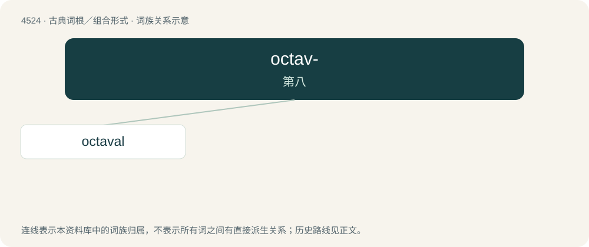

# 4524 · octav- — 第八

[总目录](../00_总目录_按常用程度.md)

**类型**：古典词根／组合形式　｜　**来源语言**：拉丁语

## 核心含义与来源

- 核心含义：第八
- 英文含义：eighth
- 词形：octav-

**来源词形**：octāvus

## 词族图

## 单词速览（常用到不常用）

| 单词 | 音标 | 释义 |
|---|---|---|
| [octaval](#w-1) | 英 /ɒkˈteɪvəl/；美 /ɑkˈteɪvəl/ | 【英文】Of, pertaining to, or relating to an octave. |

## 逐词详解

### 1. octaval

**词性**：形容词　｜　**音标**：英 /ɒkˈteɪvəl/；美 /ɑkˈteɪvəl/

**英文义项**：Of, pertaining to, or relating to an octave. / Proceeding by intervals of eight.

**构词拆分**：octave + -al

**词源与演化**：

From octave + -al.
