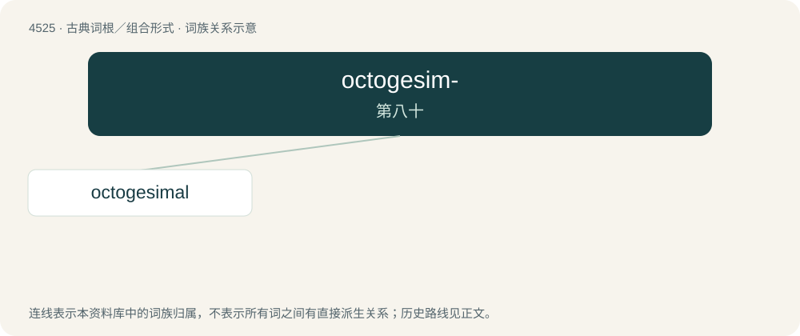

# 4525 · octogesim- — 第八十

[总目录](../00_总目录_按常用程度.md)

**类型**：古典词根／组合形式　｜　**来源语言**：拉丁语

## 核心含义与来源

- 核心含义：第八十
- 英文含义：eightieth
- 词形：octogesim-

**来源词形**：octogesimus

## 词族图

## 单词速览（常用到不常用）

| 单词 | 音标 | 释义 |
|---|---|---|
| [octogesimal](#w-1) |  | 【英文】Based on the number eighty; used to describe the Réaumur scale. |

## 逐词详解

### 1. octogesimal

**词性**：形容词

**英文义项**：Based on the number eighty; used to describe the Réaumur scale.
